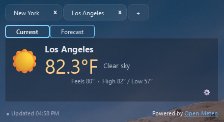

# 🌦️ TrayWeatherApp

A lightweight **system tray weather monitor** for Windows and Linux built with **Python 3.11+** and **PyQt6**.  
TrayWeatherApp provides real-time weather updates, quick forecasts, and customizable themes — all from your system tray.

## Features

- Current weather and five-day forecasts for multiple cities.
- Fixed Normal and Compact views, with remembered city tabs and window position.
- Weather icon or temperature-only tray display.
- System appearance, eight bundled themes, and custom theme import/export.
- Background transparency and optional rounded corners.
- Cached weather and forecasts when offline, with freshness and error details.
- Imperial or Metric units and 12- or 24-hour clocks.

## Download and run

Download the appropriate archive from [Releases](https://github.com/evil1dwk/TrayWeatherApp/releases),
extract it, and launch `TrayWeatherApp.exe` on Windows or `TrayWeatherApp` on Linux.
Portable builds do not require a separate Python installation.

Click the tray icon to show or hide the panel. Use **+** to add cities and the
gear button to open Settings. Right-click the tray icon for **Quit**.

## Run from source

Requires Python **3.11+**. From the repository root:

```bash
python -m venv .venv
# Windows: .venv\Scripts\activate
# Linux: source .venv/bin/activate
python -m pip install -e .
python -m TrayWeatherApp
```

## Documentation

- [User guide](docs/usage.md): cities, tray controls, views, forecasts, offline behavior, and Linux window positioning.
- [Customization and configuration](docs/customization.md): themes, transparency, rounded corners, and saved settings.
- [Theme format and compatibility](docs/themes.md): custom JSON themes and legacy ZIP imports.
- [Development, builds, and releases](docs/development.md): tests, packaging, versioning, and project structure.
- [Changelog](CHANGELOG.md): version history.

## Screenshots

### Light


### Dark


### Transparent background

Background opacity is adjustable in Settings. Text and weather icons stay fully opaque.


