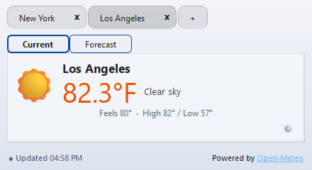
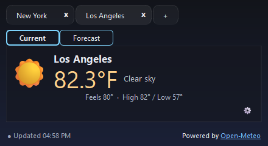

# 🌦️ TrayWeatherApp

A lightweight **system tray weather monitor** for Windows and Linux built with **Python 3.11+** and **PyQt6**.  
TrayWeatherApp provides real-time weather updates, quick forecasts, and customizable themes — all from your system tray.





---

## 🧭 Features

- 🌡️ **Live weather data** for multiple cities  
- 🎨 **Customizable themes** (Dark, Light, Beach, etc.)  
- ⚙️ **Settings persistence** — city, units, theme, and window layout are saved  
- 📍 **Tray icon controls** — right-click for menu options:
  - *Refresh Weather*
  - *Change City*
  - *Switch Theme*
  - *Quit*
- 💾 **Local configuration** saved under your user profile
- 🖥️ **Cross-platform support** — works on both Windows and Linux

---

## Installation and development

Requires Python **3.11+** on Windows or Linux. From the repository root:

```bash
python -m venv .venv
# Windows: .venv\Scripts\activate
# Linux: source .venv/bin/activate
python -m pip install -e .
python -m TrayWeatherApp
```

The installed command `trayweatherapp` also launches the app. Use
`python -m TrayWeatherApp --version` to display its version without opening the GUI.
The module name is case-sensitive on Linux.

## Unit tests

```bash
python -m unittest discover -s tests -v
```

Tests include offscreen Qt widget checks, mock weather requests, and use temporary
settings/theme directories; no API
access or running desktop is required. A manual **Unit tests** GitHub Actions
workflow covers Windows, Linux, and macOS with Python 3.11 and 3.14.
macOS test coverage does not imply a supported macOS executable build.

## Building

```bash
python -m pip install -e ".[build]"
python scripts/build.py
# Full build output:
python scripts/build.py --verbose
```

Build on the target operating system. The executable and release archive go to
`dist/`:

- Windows: `TrayWeatherApp.exe` and `TrayWeatherApp-2.3.0-windows-<arch>.zip`
- Linux: `TrayWeatherApp` and `TrayWeatherApp-2.3.0-linux-<arch>.tar.gz`

There is no Windows installer step. Archives contain the standalone executable
and any optional theme ZIPs from `themes/`. Extract before launching. Linux
archives preserve executable permissions. Built-in themes are included inside the executable; no writable application
folder is required.

The build script resolves paths from its own location, so it also works when
invoked by absolute path from another directory. Platform configurations live
in `packaging/windows/build.json` and `packaging/linux/build.json`, matching
TrayNSLookup. Temporary PyInstaller files go to the ignored `build/` folder.

To create an installable Python wheel:

```bash
python -m pip wheel . --no-deps --wheel-dir dist
```

## Versioning

Current version: **2.3.0**. This is the target for the first published release.

`TrayWeatherApp/_version.py` is the single version source for Python package
metadata, the application, and release archive names. Use **MAJOR.MINOR.PATCH**:
major for incompatible changes, minor for compatible additions, patch for fixes.
Builds never increment the version. Release tags should look like `v2.3.0`.

## Project layout

- `pyproject.toml`: package metadata, runtime dependencies, and optional build tools
- `TrayWeatherApp/`: application package and module entry point
- `tests/`: standard-library unittest suite
- `scripts/build.py`: executable build and release archive creation
- `packaging/<platform>/build.json`: tracked PyInstaller configuration
- `build/`: temporary build files (ignored)
- `themes/`: optional portable theme ZIP files
- `dist/`: executable and release archive output (ignored)

## Linux window positioning

On Linux, the application defaults to Qt's xcb backend when DISPLAY is available.
On a Wayland desktop this uses XWayland, allowing the app to query and restore
window positions. XWayland and Qt's X11 runtime dependencies must be installed.
The same startup behavior applies to source and standalone executable launches.

You can test it explicitly:

    QT_QPA_PLATFORM=xcb python -m TrayWeatherApp

An explicit QT_QPA_PLATFORM setting is preserved. To opt back into native Wayland:

    QT_QPA_PLATFORM=wayland python -m TrayWeatherApp

Native Wayland may prevent applications from restoring top-level window positions.
Window geometry is saved when quitting through the tray menu.

## Tray window controls

The weather panel has no title bar or minimize/maximize/close buttons. Click the
tray icon to show or hide it, and drag the panel background or weather text to
move it. Tab buttons, Settings gears, and links keep their usual actions.
Positions are saved when hiding or quitting. Use **Quit** in the tray menu to
exit; Alt+F4 hides the panel. Settings and other dialogs retain normal controls.

## Normal and Compact views

Choose **Normal** or **Compact** under **View** in Settings. Both layouts keep the
weather icon visible and use a fixed window size; manual resizing and maximizing
are disabled. Save applies and remembers your choice. Cancel leaves the current
view unchanged. The Settings preview also reflects the selected view.

Normal uses 760 × 500 logical pixels; Compact uses 440 × 240.
Compact is a horizontal summary with a small icon, city, temperature, conditions,
feels-like/high/low line, and update footer. Hover for the full location,
humidity, wind, local city time, or detailed update status. The footer gear opens
Settings. Existing saved window
positions are retained. Older arbitrary window sizes are replaced by the chosen
view size.

## Weather freshness and cities

Each weather card shows the last successful download in your computer's local
time, its age, and whether it is up to date, refreshing, cached, or unable to
refresh. Readings become stale after 30 minutes. An error keeps the last good
weather visible; hover over the status for the error details.

Successful results are saved to ~/.TrayWeatherApp/weather-cache.json and restored
immediately at startup while a fresh request runs. The cache is separate for each
location and unit system. It is bounded to 200 entries and may be deleted to reset it.

Click **+** to search cities or postal codes. Select a result showing its
state/province, country, and coordinates. Selected coordinates are saved so future
refreshes use that exact location. Existing city-name settings continue to work;
their coordinates are remembered after the next successful refresh. To correct an
old ambiguous city, remove its tab and add it again through the search dialog.

## Themes

Choose **System**, **Light**, **Dark**, or one of the other bundled presets in
Settings. System follows the OS appearance preference when available, with Dark
as its fallback. Existing saved selections are retained.

Settings shows a sample weather card before you Save. Cancel leaves the running
theme unchanged. Use **Import Theme**, **Export Theme**, and **Open Themes Folder**
to manage custom JSON themes or import existing theme ZIPs.

Built-in themes ship inside the application. Custom themes live under
~/.TrayWeatherApp/themes/; settings retain their existing location at
~/.TrayWeatherApp/pyqt_tray_weather.json (under your user profile on Windows).
See [Theme format and compatibility](docs/themes.md) for examples and details.

The tray menu's **About TrayWeatherApp** shows the current application version,
creator, project link, and issue link.

---

## ⚙️ Configuration File

TrayWeatherApp saves user settings in a JSON file:
```json
{
  "cities": ["New York"],
  "units": "imperial",
  "window_pos": [722, 575],
  "window_size": [1195, 425],
  "debug": false,
  "time_format_24h": false,
  "theme": "Dark"
}
```
You can delete this file to reset settings.

---
